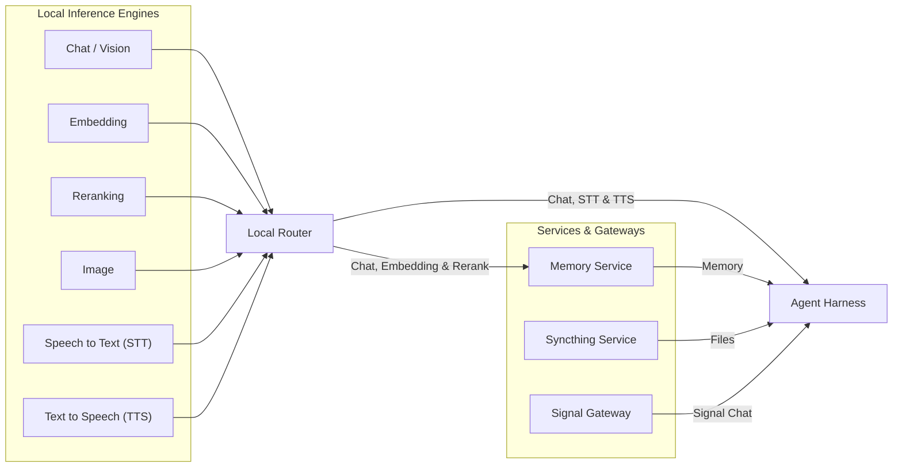

# **Local Inference** And Sandboxed **Agents Service** Infrastructure

This repository contains orchestration for deploying sandboxed local AI assistants and developer runtimes using local inference services.

It provides **`sandbox-ctl`** (a generalized systemd and bubblewrap container launcher), systemd-confinement configurations, and standardized daemon control utilities (`*-ctl` scripts) to ensure secure, isolated agent execution.

## Services

### Local Inference

| Service | Default Port(s) | Description / Protocol |
|---------------|-----------------|------------------------|
| **[Local Chat/Vision](#local-chat-services)** | [20080](http://localhost:20080) | Strata-Engine or Llama-server serving Chat/Vision LLM |
| **[Local Embedding](#local-embedding-services)** | [20082](http://localhost:20082) | llama-server or TEI (text-embeddings-router) serving Text Embeddings |
| **[Local Reranking](#local-reranking-services)** | [20086](http://localhost:20086) | Llama-server serving Document Reranking |
| **[Local Speech to Text](#local-speech-to-text)** | [20090](http://localhost:20090) | Whisper-server audio transcription API (HTTP) |
| **[Local Text to Speech](#local-text-to-speech)** | [20095](http://localhost:20095) | Kokoro-82M ONNX (default) or Qwen3-TTS audio synthesis API (HTTP) |
| **[Local Image Generation](#local-image-services)** | [20100](http://localhost:20100) | sd-server serving Image Generation API (HTTP) |
| **[Local Memory Service](#local-memory-service)** | [28888](http://localhost:28888), [28889](http://localhost:28889), [8890](http://localhost:8890) | Hindsight API (28888), Worker Control Plane (28889) & Control UI (8890) |
| **[Local Router](#local-combined-inference-router)** | [21080](http://localhost:21080) | Combined service router / OpenAI proxy (HTTP) |
| **[Local Inference Coordinator](#local-inference-coordinator)** | - | Combined service control script |

### Integration Services
| Service | Default Port(s) | Description / Protocol |
|---------------|-----------------|------------------------|
| **[Signal Integration](#signal-integration)** | [20889](http://localhost:20889), [20888](http://localhost:20888), 20887 |REST-API:20889, HTTP/JSON-RPC: 20888, TCP/JSON-RPC:20887 |
| **[Syncthing Integration](#syncthing-integration)** | [8384](http://localhost:8384), 22000 | Syncthing Web UI (HTTP) & Sync Protocol (TCP/UDP) |

## Sandboxing & Container Isolation (`sandbox-ctl`)

The repository includes **`sandbox-ctl`** (`scripts/sandbox-ctl`), a generalized execution wrapper that runs any CLI tool, coding agent (like OpenCode), or GUI application inside an isolated Linux container sandbox.

### Key Sandboxing Features
- **Dual Execution Engines**: Automatically selects native **systemd transient units (`systemd-run`)** for cgroups v2 resource accounting and security hardening, or falls back to **Bubblewrap (`bwrap`)** containers.
- **Persistent Relocated Home**: Maps an isolated sandbox home (`~/.local/sandbox/<app>`) as `$HOME` inside the container—the container cannot see or mutate your real home directory.
- **Specialized Shell Modes**:
  - `hotshell <app>`: Interactive hot shell with SSH agent auto-discovery, D-Bus, user systemd, user Podman socket, and KeePassXC browser socket forwarding (`<app> 🟣`).
  - `hotshell --sudo <app>`: Enables desktop GUI root privilege escalation (`<app> 🟣⚡`).
  - `hotshell --gui <app>`: Enables Wayland, GPU acceleration, audio, and IPC sharing (`<app> 🟣🎨`).
  - `hotshell --all-access <app>`: Mounts real host `$HOME` read/write at `~/real_home` and maps host user runtime read/write for unconfined debugging (`<app> 🚨`).
  - `guishell <app>`: Interactive shell configured for graphical and GPU-accelerated applications (`<app> 🎨`).
- **Desktop GUI Root Privilege Escalation (`sudo` & `pkexec`)**:
  - Container `sudo` and `pkexec` communicate with host PID 1 via the System D-Bus socket (`/run/dbus/system_bus_socket`), triggering the native GNOME Shell modal password dialog on the desktop. Zero setuid binaries needed inside the container.
  - **Infinite Wait Timeout**: Sets `SYSTEMD_BUS_TIMEOUT="infinity"`, keeping the desktop dialog open until approved or cancelled (matching `pamac`).
  - **In-Memory Sliding-Window Cache**: Managed via `sandbox-ctl system sandbox-sudo.rules install`. Authenticates once via the desktop dialog and caches authorization in `polkitd` RAM for 5 minutes, automatically resetting the timer on every subsequent command with zero disk I/O.
- **System Configuration Manager**:
  - `sandbox-ctl system sandbox-sudo.rules <install|status|cat|uninstall>`: Automated management of host Polkit rules.

For complete usage styles, environment options, and architecture details, see **[docs/tools/sandbox-ctl.md](docs/tools/sandbox-ctl.md)**.

## Assistant/Agent Services

Each assistant in this repository is managed by a dedicated shell wrapper script (`assistants/<assistant>-ctl`) adhering to standard design and lifecycle management guidelines.

| Agent | Language | Default Port(s) | Description |
| :--- | :---: | :---: | :--- |
| **[ZeroClaw](#zeroclaw)** | Rust | [42617](http://localhost:42617) | ZeroClaw Gateway |
| **[IronClaw](#ironclaw)** | Rust | [28080](http://localhost:28080) | IronClaw Web Gateway & HTTP Webhooks |
| **[LibreFang](#librefang)** | Rust | [4545](http://localhost:4545) | LibreFang daemon API (HTTP) |
| **[Hermes](#hermes)** | Python | [8642](http://localhost:8642), [9119](http://localhost:9119) | Hermes Gateway (API: 8642, UI: 9119) |
| **[NanoBot](#nanobot)** | Python | [8790](http://localhost:8790) | NanoBot Gateway API |
| **[PicoClaw](#picoclaw)** | Go | [18790](http://localhost:18790), [18800](http://localhost:18800) | Gateway (HTTP/Webhook) & Launcher Web UI |
| **[NanoClaw](#nanoclaw)** | TypeScript | [3000](http://localhost:3000) | Webhook Server |

- See [Assistants Common Guide](docs/assistants/index.md) for general usage and common configuration options.
- See [Current Weekly Development Status](docs/research/weekly-devel-activity.md) for GIT development.

## Helper Utilities

The repository contains several scripts under `scripts/` to assist with sandboxing, downloading models, and calibrating agent runtimes, plus benchmark harnesses and results under `benchmarks/`.

For details, see [docs/tools/index.md](docs/tools/index.md) and [docs/benchmarks/index.md](docs/benchmarks/index.md).

## Repository Structure

- `README.md` — Agent/script instructions, default ports, and isolation requirements
- `docs/` — MkDocs documentation site (`make docs` / `make docs-serve`) covering inference, assistants, integrations, tools, benchmarks, and research
- `scripts/sandbox-ctl` — Generalized systemd/bubblewrap container launcher and environment manager (documentation: [docs/tools/sandbox-ctl.md](docs/tools/sandbox-ctl.md))
- `assistants/` — Daemon control scripts (`*-ctl`, `local-*.sh`)
- `scripts/` — Model downloader (`local-download.sh`), router, launchers, and utility tools
- `benchmarks/` — Local inference and Strata benchmark scripts, comparative reports, and run results (`results/`)
- `skills/` — Portable skill definitions
- `scratch/` — Workspace for temporary files and checkout sources (`scratch/*-sources`)

## System Architecture

## Local Inference and Integrations

### Local Chat Services
- **Description**: Manages persistent `llama-server` or `strata-engine` instances for chat/vision LLM completions (`local-chat.sh`, `local-chat-strata.sh`).
- **Sandboxing**: Requires `PrivateDevices=no` to access `/dev/dri` and `/dev/kfd`. Enforces `ProtectSystem=strict` while bind-mounting the user's home configuration and granting read-write access to `/data/public/machine-learning`.
- **Features**: Chat completions (`20080`) service
    - serving the main model with 3 parallel slots (80,000 tokens context size each, total 240,000 tokens). 
    - optionally serving a code completion model (`qwen-coder-fim`) with native Fill-in-the-Middle (FIM) support for editor tab completion.
- Documentation: [chat.md](docs/inference/chat.md) (and [chat-strata.md](docs/inference/chat-strata.md))

### Local Embedding Services
- **Description**: Manages persistent text embedding servers (`local-embedding.sh`). Supports two backend engines:  `llama-server` (GGUF) and  TEI `text-embeddings-router`.
- **Sandboxing**: Requires `PrivateDevices=no` to access `/dev/dri` and `/dev/kfd`. Enforces `ProtectSystem=strict` while bind-mounting the user's home configuration and granting read-write access to `/data/public/machine-learning`.
- **Features**: Standalone text embedding server (`20082`) with mean pooling, ROCm GPU offloading, dynamic batching, and systemd sitecustomize helper patch.
- Documentation: [embedding.md](docs/inference/embedding.md)

### Local Reranking Services
- **Description**: Manages persistent `llama-server` instances for document reranking (`local-rerank.sh`). 
- **Sandboxing**: Requires `PrivateDevices=no` to access `/dev/dri` and `/dev/kfd` for GPU-accelerated synthesis (unless run in cpu only mode). Enforces `ProtectSystem=strict` while restricting filesystem access to the home directory and read-only system files.
- **Features**: Rerank Service (`20086`) services.
- Documentation: [rerank.md](docs/inference/rerank.md)

### Local Speech-to-Text
- **Description**: Manages a persistent `whisper-server` instance for speech-to-text (STT) transcription. Serves an OpenAI-compatible audio transcription API on port 20090.
- **Sandboxing**: Requires `PrivateDevices=no` to access `/dev/dri` and `/dev/kfd` for GPU-accelerated synthesis (unless run in cpu only mode). Enforces `ProtectSystem=strict` while restricting filesystem access to the home directory and read-only system files.
- **Features**: audio transcoding using `ffmpeg`.
- Documentation: [speech-to-text.md](docs/inference/speech-to-text.md)

### Local Text-to-Speech
- **Description**: Manages persistent Text-to-Speech (TTS) voice synthesis services exposing an OpenAI-compatible audio synthesis API on port 20095. Defaults to **Kokoro-82M ONNX** (`scripts/kokoro-ctl.py`), with optional **Qwen3-TTS** (`qwen3-tts-server`) GGUF serving.
- **Sandboxing**: Runs purely on CPU with AVX2 MLAS acceleration, consuming **0 MB discrete GPU VRAM** and ~350 MB host RAM. Enforces `ProtectSystem=strict` with sandbox isolation.
- **Features**: 4.6× – 5.1× real-time synthesis, native accent-free German (`df_victoria`, `dm_martin`) and English (`af_heart`, `am_adam`) voice lineups, length-indexed style embedding lookup (`voice[L-1]`), voice blending, multi-speaker inline dialogue, silence pauses, chunked streaming, OGG/Opus compressed output, in-process audio playback via `python-sounddevice`, and OpenAI API fallback cascades.
- Documentation: [text-to-speech.md](docs/inference/text-to-speech.md)

### Local Image Services
- **Description**: Manages a persistent `sd-server` instance for image generation. Serves an OpenAI-compatible image generation API on port 20100.
- **Sandboxing**: Requires `PrivateDevices=no` to access `/dev/dri` and `/dev/kfd` for GPU-accelerated generation (unless run in `cpu` mode). Enforces `ProtectSystem=strict` while restricting filesystem access to the home directory and read-only system files.
- **Features**: Generates images using the `z_image_turbo-Q8_0.gguf` model with options for sampler steps, CFG scale, and backend routing.
- Documentation: [image.md](docs/inference/image.md)

### Local Memory Service
- **Description**: Manages a persistent Hindsight memory instance served by `hindsight-api` (port 28888) with a dedicated background task worker sidecar `hindsight-worker` serving a control plane / metrics HTTP server on port 28889 (`local-memory.sh`).
- **Sandboxing**: Enforces `ProtectSystem=strict` with `PrivateDevices=yes` and standard systemd hardening. Restricts filesystem access to the home directory (`BindPaths=%h`).
- **Features**: Long-term temporal, semantic, and entity-graph memory engine offloading embeddings, LLM reasoning, and reranking to `local-router` (port 21080) and PostgreSQL (`pgvector` + `pgroonga`). Worker control plane port configurable via `HINDSIGHT_API_WORKER_HTTP_PORT` (set to 0 to disable).
- Documentation: [memory.md](docs/inference/memory.md)

### Local Combined Inference Router
- **Description**: Manages a persistent FastAPI web application served by `uvicorn` that aggregates all underlying local inference services into a single OpenAI-compatible entrypoint (`local-router.sh`).
- **Sandboxing**: Enforces `ProtectSystem=strict` with `PrivateDevices=yes` (no GPU access required). Restricts filesystem access to the home directory (`BindPaths=%h`) and standard system directories read-only.
- **Features**: OpenAI-compatible routing for chat completions, embeddings, reranking, transcription, speech, and image generation. Comprehensive token usage tracking, estimated cost calculation, static HTTP error code logging (`errors_streaming` / `errors_post`), pre-formatted ASCII table reporting (`/usage?format=text`), scrapable Prometheus metrics (`/metrics`), startup synchronization checking, default model fallback routing, and graceful OpenAI-format gateway error propagation.
- Documentation: [router.md](docs/inference/router.md)

### Local Inference Coordinator
- **Description**: Coordinator and wrapper script to manage the installation, state, and activation of all 7 local services (`local-inference.sh`).
- **Sandboxing**: Not a system service itself, but executes individual service scripts which utilize systemd user sandboxing.
- **Features**: Bulk installation, uninstall, lifecycle control (start, stop, restart), status reports, combined logs, and automatic propagation of environment overrides (e.g. LRR_OVERRIDE) to target services.
- Documentation: [inference/index.md](docs/inference/index.md)

### Signal Integration
- **Description**: Connects agents to Signal. Runs a `signal-cli` daemon exposing both TCP and HTTP JSON-RPC interfaces. It also provides an optional Go-based REST API wrapper for robust, HTTP-based polling/webhook integrations (like linking LibreFang).
- **Sandboxing**: Standard filesystem hardening, but disables `MemoryDenyWriteExecute` because the underlying JVM (Java) requires it for JIT compilation. 
- **Features**: Account linking via QR code, dual daemon interfaces, and isolated home directory execution to prevent contamination.
- Documentation: [signal.md](docs/integrations/signal.md)

The following assistants have native Signal channel integration available in their source code:
- [Hermes](docs/assistants/hermes.md)
- [IronClaw](docs/assistants/ironclaw.md)
- [LibreFang](docs/assistants/librefang.md)
- [NanoBot](docs/assistants/nanobot.md)
- [ZeroClaw](docs/assistants/zeroclaw.md)

To configure them, refer to their specific configuration sections in their respective control guides.

### Syncthing Integration
- **Description**: Manages a persistent, confined Syncthing file synchronization daemon.
- **Sandboxing**: Standard systemd strict filesystem confinement with a transient tmpfs home, mapping only configured directories. Exposes the host configuration and state directories.
- **Features**: Decentralized and secure background file synchronization for agent workspaces and shared data.
- **Documentation**: [syncthing.md](docs/integrations/syncthing.md)

